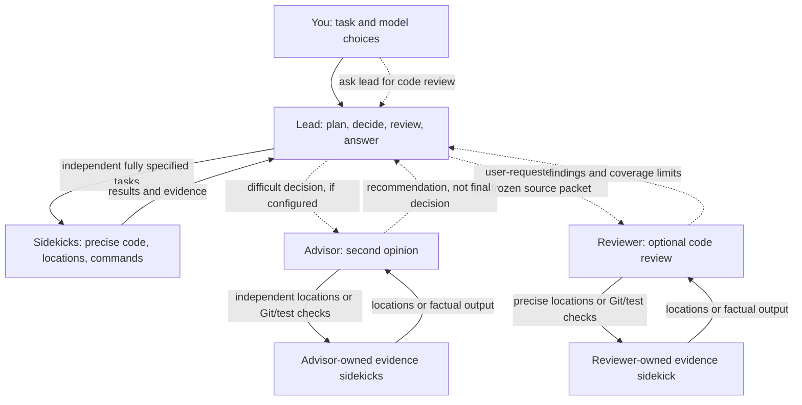
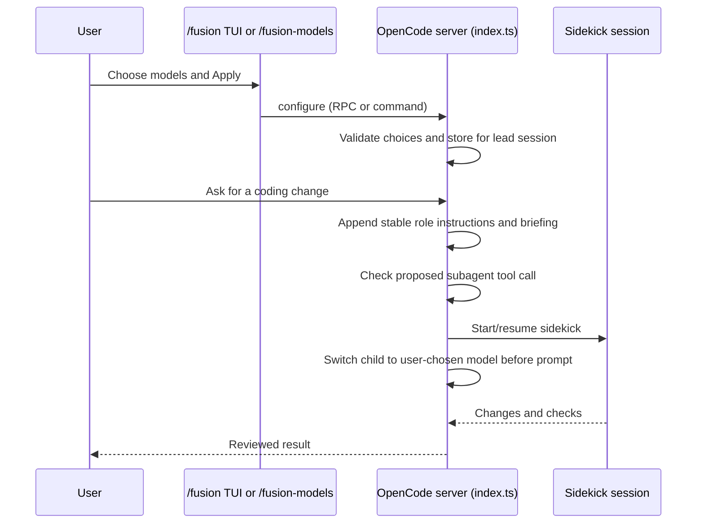

# Fusion Bigg Boss: how it works

## In plain English

Fusion is a way to organize a coding assistant as a small team. **You choose the models** (and their available thinking effort); Fusion does not pick or silently substitute them. The lead stays responsible for understanding your request, making decisions, reviewing work, and answering you. It can hand off bounded jobs to specialists without handing off responsibility.



| Actor | Role | Can do | Important boundary |
| --- | --- | --- | --- |
| **You** | Owner of the setup | Pick each role's model/effort and authorize the task | No agent is allowed to choose a substitute model for you. |
| **Lead** | Planner, coder and reviewer | Read/analyze source, choose the approach, code directly (including multi-file work), delegate, review, answer | Direct shell/search is restricted; focused reads allow 350 lines per call. Delegate only fully specified work when worthwhile. |
| **Sidekick** | Execution worker | Precise coding changes, location-only file lookups and specified Git/check/retrieval jobs | No ambiguous exploration, analysis, autonomous repair loops or nested agents. Return failures/ambiguity to the caller. |
| **Advisor** | Optional read-only sounding board | Read/analyze focused source, challenge assumptions and use its own precise evidence sidekick | No coding, direct shell/web or user contact. Reads allow 350 lines; unavailable/disabled skips the consultation. |
| **Reviewer** | Optional read-only review specialist | Analyze the user-requested snapshot with 350-line reads, installed skills and its own precise evidence sidekick | User-request-only instruction policy; no coding, direct shell/web or other agents. Lead owns fixes and the final answer. |

The lead and sidekick also receive a short **minimal-solutions** rule: understand the actual flow, reuse existing code or platform features, and prefer the smallest *clear and safe* change. It does not override the requested behavior, security, validation, accessibility, or useful tests. This rule is in the Copilot profiles, OpenCode's per-turn context hook, and Pi's role prompts; there is no Ponytail dependency or mode switch.

### A typical request

1. You select Fusion and choose models for the roles you need.
2. The lead reads and interprets focused source itself. A precise file-location lookup returns paths/ranges/symbols only for the lead to read.
3. The lead codes directly or delegates an exact change/check job with known inputs, scope and stop conditions. Sidekicks return factual results or blockers, not autonomous analysis or repairs.
4. For a risky decision, the lead *may* ask the read-only advisor. Advisor/reviewer roles can read source and use separate persistent evidence sidekicks for precise locations or specified Git/test checks; the lead still decides and fixes.
5. The lead inspects the integrated changes and evidence, then answers you. The advisor gives advice, not the final decision.

Code review by the optional reviewer is a user request, not an automatic gate after implementation. Ask normally, for example “Do a code review with the Fusion reviewer”; the lead invokes it through native delegation without a command, token, or user-supplied session ID. The lead is instructed to invoke it only for explicitly requested code review, choosing a retained conversation for the same change or starting fresh for unrelated work. Missing-evidence follow-ups stay within that review; a separate re-review needs another request. User intent is an instruction policy, not a runtime classifier. The lead prepares a neutral packet identifying baseline/snapshot, requirements, unchanged contracts, affected flow, complete scoped diff and relevant source/tests, reported checks, and uncertainties. Frozen artifacts account for untracked/ignored files; summaries orient the reviewer but do not replace code. A different model family from the lead/author is recommended, not detected or enforced. Installed review skills are managed outside Fusion; the default suggestion is `code-review-and-quality`.

Lead, advisor and reviewer reads allow **350 lines per call**. They read and interpret caller/contract/test context themselves rather than delegating analysis. Sidekicks only locate matches or execute fully specified jobs; reviewer/advisor workers preserve source and any frozen snapshot. Lead and advisor callers may retain multiple sidekick sessions and run independent specified jobs in parallel. Omit the worker ID to start one; pass its confirmed ID for related follow-ups. Each worker has at most one active task; coordinate conflicting writes and stable-tree checks. The reviewer retains one persistent evidence sidekick.

Callers can inspect available progress, steer, and cancel their own running workers. A request to wrap up or summarize is an ordinary message; cancellation is a separate caller decision with no automatic timeout. Lead controls direct sidekick/advisor/reviewer workers, while advisors/reviewers control their own evidence workers. Background execution leaves callers free to intervene. Steering acknowledgement means queued rather than obeyed; cancellation preserves histories, partial output and existing edits, and does not guarantee an instant stop or final summary.

## From first principles: what is a plugin here?

An **agent definition** is a role's written instructions and, where supported, declared permissions or tools. It encourages behavior but is not by itself a security boundary. A **runtime hook** runs in the host application at a specific moment (such as before a tool call) and can reject an invalid action. **State** remembers user selections and worker identity across turns. A **host adapter** connects these ideas to Copilot CLI, OpenCode V2, or Pi, whose plugin APIs differ.

OpenCode is the behavioral reference for the adapters. Pi and Copilot preserve its role boundaries, explicit model choices and worker lifecycle as far as their native SDKs permit. Each adapter uses its own native runtime to provide consistent observable behavior. Native task terminal states, available tools and session-navigation semantics remain host-specific and are called out in the adapter guides.

```text
ai4corp-fusion-bigg-boss/
├── README.md                         install, configuration, limits
├── ARCHITECTURE.md                   this conceptual and file map
├── plugin.json                       Copilot Agent Plugins identity/version
├── package.json                      Node dependencies, exports, test commands
├── com.github.copilot/               Copilot CLI adapter (auto-discovered in plugin)
│   ├── agents/
│   │   ├── fusion.agent.md            lead's standing instructions
│   │   ├── fusion-sidekick.agent.md   coding worker's instructions
│   │   ├── fusion-advisor.agent.md    read-only advisor with evidence jobs
│   │   └── fusion-reviewer.agent.md   user-invoked read-only reviewer
│   └── extensions/fusion-guard/
│       ├── extension.mjs              starts the Copilot SDK extension
│       ├── hooks.mjs                  pre-tool checks and prompt status
│       ├── commands.mjs               user-only /fusion setup
│       ├── state.mjs                  private last setup and bounded recents
│       ├── policy.mjs                 which tool calls are allowed
│       ├── availability.mjs           shared command/guard model-configuration checks
│       ├── identity.mjs               recognize *this* plugin's roles
│       └── roles.mjs                  verify child roles/ancestry from events
├── ai.opencode/                      OpenCode V2 adapter (configured separately)
│   ├── agents/{fusion,...}.md         four OpenCode agent definitions
│   ├── index.ts                       server plugin: models, state, hooks, commands
│   ├── context.ts                     session-selected aliases with native context limits
│   ├── tui.ts                         /fusion interactive model picker
│   ├── rpc.ts                         typed TUI ↔ server methods
│   ├── index.test.ts                  server plugin behavior tests
│   └── tui.test.ts                    picker tests
├── pi/                               Pi 0.87.1 adapter (separate host SDK)
│   ├── index.ts                       commands, role prompt, root guard and delegation
│   ├── state.ts                       model choices, branch state and private recents
│   ├── worker.ts                      isolated child SDK sessions and ownership
│   └── *.test.ts                      fake-provider SDK and no-inference loader checks
├── skills/fusion-delegation/SKILL.md  canonical delegation-briefing text
├── shared/
│   ├── briefing.mjs                   extracts lead, completion, and reviewer guidance
│   ├── context.mjs                    local context-budget suffix and capacity validation
│   └── git-command.mjs                identifies Git for Copilot's sidekick identity check
├── scripts/
│   ├── generate-briefing.mjs          copies canonical sections into Copilot profiles
│   └── verify-opencode-loader.mjs     isolated OpenCode source-load check
└── tests/                             Copilot guard, packaging, briefing tests
```

The `ai.opencode/` directory is **not** a Copilot plugin folder. Conversely, `plugin.json` and `com.github.copilot/` are **not** what OpenCode or Pi loads. Copilot gets the shared briefing through a generation script; OpenCode and Pi load it at adapter setup. All adapters implement roles and enforcement through their own APIs.

### Why `shared/` and `scripts/` are separate

Think **`shared/` = reusable functions** and **`scripts/` = commands a developer runs**.

```text
During normal use:
  OpenCode index.ts ──────> shared/briefing.mjs ──> reads the briefing skill
  Pi index.ts ────────────> shared/briefing.mjs ──> reads the briefing skill
  Copilot hooks.mjs ──────> shared/git-command.mjs ──> verifies Git caller routing
  Copilot agent .md files ──> already contain a copy of the briefing text

When maintaining the plugin:
  npm run sync:briefing
    └─> scripts/generate-briefing.mjs
          ├─> reads the master guide via shared/briefing.mjs
          └─> writes marked briefing sections in Copilot agent .md files
  scripts/verify-opencode-loader.mjs ──> temporary, private OpenCode server
                                        ──> confirms the plugin loads
```

| File | In everyday terms | When does it run? |
| --- | --- | --- |
| `shared/briefing.mjs` | Reads and checks the one master delegation guide in `skills/fusion-delegation/SKILL.md`; produces the full lead briefing, worker completion/return section, and reviewer contract. | OpenCode and Pi load it at adapter setup; the generation command also calls it. |
| `shared/git-command.mjs` | Recognizes ordinary Git commands so Copilot permits them only for its verified sidekick; this is not a shell sandbox. | Copilot's relevant descendant shell calls. OpenCode and Pi no longer use it. |
| `scripts/generate-briefing.mjs` | Copies the master guide into the marked briefing sections of the Copilot lead/sidekick/reviewer Markdown files, not their other role instructions. Copilot reads those files; it does not run this script for you. | **Only when you run `npm run sync:briefing`**, after editing the master skill. `--check` only checks whether copies are current. |
| `scripts/verify-opencode-loader.mjs` | Starts an isolated OpenCode server, checks that the local plugin and command load, then shuts it down. It does not ask an AI model anything. | **Only when you run it** as a diagnostic. Not required for ordinary Copilot or OpenCode conversations. |

If you change **only** a Copilot agent profile or OpenCode adapter, you normally do **not** sync the briefing. If you change the **master briefing skill**, run `npm run sync:briefing` to update Copilot's marked copies; OpenCode will read the updated skill on its next plugin setup. `npm test` checks for stale copies without writing them.

### Copilot CLI: profile + guard

Copilot loads `plugin.json` and discovers four profiles under `com.github.copilot/agents/`. The lead-owned sidekick handles precisely specified shell/search/coding/retrieval jobs, including native web search/fetch where available. Read-only advisor/reviewer profiles expose finite text views and native task/write/read-agent calls only for their own evidence sidekicks; reviewer also loads skills. The resolver verifies root → advisor/reviewer → evidence-sidekick ancestry, while coding workers remain direct root children. Evidence workers lack named editing/web/delegation tools; shell side effects remain instruction-governed. Advisors support foreground or background consultation; native follow-up writes require a background worker.

The extension entrypoint, `extension.mjs`, attaches `hooks.mjs` to the Copilot session. On each relevant tool call, the pre-tool hook checks identity, ancestry, and policy **before** allowing it. `identity.mjs` checks the packaged lead's real filesystem path, resolving local-marketplace symlinks without accepting another plugin's similarly named agent. `roles.mjs` correlates child-start and tool-call events, including a replay of the event log after reconnecting. `policy.mjs` rejects disallowed tool routes, model overrides, and excessive lead reads. The prompt hook reports whether the optional advisor is configured; it does not pick models.

The extension registers `/fusion` through SDK `joinSession`: an interactive draft picker when elicitation is available, and text arguments otherwise. Explicit Apply selects the verified packaged lead, switches its model/effort, and merges worker model/effort selections with required enforcement into native user settings plus the current session's subagent override. Deferred/rejected switches, managed settings, and legacy settings shadows are reported instead of silently substituted. Native `/model` and `/subagents` still work independently.
`state.mjs` stores last applied setup and per-role recent three in a private, atomically replaced state file; only explicitly chosen roles enter recents after successful Apply. Opening a picker never applies remembered choices. Off permits existing workers to settle, selects the default agent, and restores the exact current model/effort if the native switch changes it; saved setup and worker settings remain. Retained workers keep their role boundaries and status/cancellation controls, while new evidence jobs and Fusion continuations are blocked. Re-enabling requires explicit Apply. Host RPC operations are not transactional, and concurrent native settings edits can race the read-modify-write merge.
`models.mjs` reads the session catalog's `list` array and both native CAPI and normalized relay capability representations. The draft, recents and saved setup include optional explicit context tiers, with backward compatibility for choices without one. Apply validates model-supported thinking/context choices, writes worker `contextTier` overrides when explicitly chosen, and confirms the lead's explicit tier; no universal context-token budgets are invented. Duplicate packaged selection IDs and unverified source/path metadata block agent selection.
Background worker continuations and live steering use native `write_agent`; `read_agent` exposes status and available output. The guard verifies allowed roles and direct ownership. `fusion_cancel` registers a targeted SDK task-cancellation tool, correlating its caller with tool-start evidence before requesting interruption of the target and verified evidence descendants. It retains partial output and distinguishes host acknowledgement from observed terminal status. Live completion notification and cancellation settlement still need host verification; routine polling is unnecessary.

Fresh work and observed idle continuations validate enabled role settings and available model/effort/context; evidence callers also validate their own role configuration. Parent cancellation closes further evidence admission before descendant discovery. Rejected cancellation releases that block; accepted cancellation requires a successful idle continuation to reopen it. Native writes combine steering with continuation, so a completion race cannot be made atomic by the guard. Terminal native tasks reject writes; a reviewer may replace terminal evidence work with an explicit handoff while retaining the old history.

For user-requested code review, the lead prepares the frozen packet and starts a configured background reviewer, or continues a confirmed same-root reviewer with one explicit `write_agent` target. A write during execution steers the current work. Configuration, ownership, status and named read-only tools remain runtime checks; user-request-only review is an instruction policy. Lead/advisor sidekick launches allow multiple independent workers; reviewer evidence launches retain a single-worker reservation. Worker controls reject cross-worker borrowing and messages/cancellation require one explicit target. Unresolved ancestry fails closed; Off prevents new evidence jobs while protected workers retain their boundaries. Ordinary non-Fusion coordination remains unaffected. Native existing-child model adoption remains unverified, not a promised switch.

This installation uses a **local marketplace symlink** pointing to this repository: `copilot plugin list` labels it *Live Plugins*. Edit the source here and start a **new Copilot session** to use the new files; no reinstall on every edit. See [README.md](README.md#copilot-cli) for the actual install steps and extension approval.

### OpenCode V2: server plugin + TUI plugin

OpenCode loads `ai.opencode/index.ts` as a server plugin from the `plugins` setting. Its four `.md` agent definitions are installed separately in OpenCode's agents directory. `index.ts` reads the shared briefing at setup and registers:

1. **Model setup:** `/fusion-models` for text/headless use, and `rpc.ts` methods (`inspect`, `validate`, `configure`, `disable`) for the interactive picker in `tui.ts` (`/fusion`). Each role's menu offers up to three recent model-and-effort choices or **Choose new model** (catalog, then effort). Model IDs are `provider/model#thinking` when a model has effort variants; `#default` is an explicit choice. Off switches the root to an available ordinary primary agent without removing its pair, history, model/effort, or children; it restores the exact model after the native agent switch if needed. Re-enabling explicitly reapplies the saved setup.
2. **State:** plugin storage records the selected model pair per lead session, the last applied setup, bounded per-role recents shared across sessions, and ownership per sidekick ID. Separate worker records avoid lost updates during parallel creation. Legacy single-sidekick records remain valid for explicit continuation; reviewer evidence retains its singleton record. Only explicitly selected roles enter recents after successful configuration; clearing an optional role retains its history. Opening the picker does not apply a remembered setup; you explicitly choose **Apply this setup**.
3. **Before-tool hook:** verifies lead → sidekick/advisor/reviewer and the sole nested exception advisor/reviewer → its own evidence sidekick. All sidekicks run in background, use the user's selected sidekick model and retain their owner's conversation. Evidence workers expose read/grep/glob/shell only; no named edits, web or further delegation. Advisor/reviewer reads cap at 350, and reviewer also loads skills. Continuing evidence jobs waits for the prior turn and rejects foreign IDs; review requires confirmed direct-root ownership. After Off, ordinary root calls are unrestricted while protected children retain their boundaries and new evidence jobs are denied. Retired utility workers cannot resume through Fusion.
4. **Context hook:** appends fixed lead/sidekick instructions and shared briefing on model calls; the minimal-solutions rule is part of that fixed text. It also restricts certain offered tools. The fixed instructions come before per-session model status, avoiding needless prompt changes from this rule between turns.
5. **Prompt hook:** corrects inherited models to the user's chosen role model *before* admission, including reviewer/advisor-owned evidence sidekicks. Reviewer admission records direct-root ownership and verifies the selected model. Each lead/advisor sidekick ID records its direct caller; omitted IDs create independent conversations and explicit IDs resume verified owned histories after native wait. Missing models fail without substitution; advisor needs tool support for its read/evidence workflow. No command grant or correlation prefix is required.

6. **Live controls:** `fusion_worker` exposes status/message/cancel for verified direct workers. It reads recent context and observed session-status events, reporting unknown status when observation is unavailable. Synthetic steering uses `resume: false` to avoid restarting an idle worker. Cancellation starts native interruption without waiting for slow settlement, records failures for later inspection, and requests interruption of recorded owned evidence descendants. Parent cancellation blocks further evidence admission. Background advisors are supported alongside foreground calls; ordinary continuation still waits for the prior turn.



The TUI and server are separate runtimes: updating `tui.ts` in source does not necessarily update an already-running server or an already-loaded TUI. See [README.md](README.md#opencode-v2) for installation and safe-reload notes.

OpenCode/Pi model choices optionally append `@100k` (or another supported local budget), after any thinking suffix. Both pickers include context selection and a budget-only edit. Default preserves native behavior; older stored strings remain valid. Shared capacity validation rejects unknown/oversized budgets. OpenCode's `context.ts` registers only requested model aliases, preserving API `modelID`, provider, variants, overlays and output limits, while reducing native context/input limits. Stored pairs rebuild aliases on plugin startup; originals and configuration files are unchanged. Native compaction operates on the alias's limit. This is not a provider tariff selection or hard token ceiling; global compaction settings and failure behavior remain the host's responsibility. Copilot continues using its existing native context tiers.

## Where should a change go?

| You want to change… | Start with… | Also check… |
| --- | --- | --- |
| Plain-English responsibilities in Copilot | `com.github.copilot/agents/*.agent.md` | Corresponding guard policy and `tests/guard.test.mjs` if the rule must be enforced |
| Role behavior in OpenCode | `ai.opencode/index.ts` and `ai.opencode/agents/*.md` | `ai.opencode/index.test.ts` |
| Copilot tool/delegation enforcement | `com.github.copilot/extensions/fusion-guard/{hooks,policy,identity,roles}.mjs` | `tests/guard.test.mjs` |
| Model picker | `ai.opencode/tui.ts`, `ai.opencode/rpc.ts` | `ai.opencode/tui.test.ts` and `ai.opencode/index.test.ts` |
| Delegation-briefing wording on **both** hosts | `skills/fusion-delegation/SKILL.md` | Run `npm run sync:briefing` to refresh marked Copilot profile sections; `shared/briefing.mjs` loads it for OpenCode |

### Pi: extension and isolated child sessions

Pi discovers `pi/index.ts` through the package's `pi.extensions` manifest, or you can launch just that extension explicitly. The extension exposes human-only `/fusion` and `/fusion-models`; setup is recorded as a custom entry in the active session branch. Private workspace-scoped history stores the last setup and per-role recent three. Only an explicit Apply changes the lead model/effort and activates branch routing. `before_agent_start` inserts stable lead instructions and the canonical briefing; `tool_call` rejects root model tools outside the bounded read/edit/write/delegate list. Manual user shell is unaffected.

`fusion_delegate` creates role-specific SDK sessions with isolated loaders and explicit model/effort checks. Durable owned IDs, controlled directories and parent headers are verified on resume; legacy root histories remain usable and are never deleted automatically. Root branch state retains worker IDs as their histories become durable for continuation and the persisted viewer. Root sidekicks execute only precise coding/lookup/command jobs. Advisor/reviewer sessions expose bounded read, owned worker controls and a narrow evidence-delegation tool on the chosen sidekick model, with read/grep/find/ls/bash and no edits/writes/nested delegation. Advisors may create parallel background evidence workers or explicitly resume their IDs; each reviewer retains automatic reuse of one evidence worker. Same-worker continuations wait for the previous task and revalidate ownership, branch/setup and models. Independent reviewers may run concurrently. Cancellation also cancels already-queued continuations; a new explicit continuation is possible after settlement. Background calls return the worker ID when that task starts and deliver results to the owner later. Root advisors support foreground or background; sidekick/reviewer calls require explicit `background: true`. Branch/session switches abort and drain active and queued work. Off retains histories and releases root routing once work settles; see [Pi's guide](pi/README.md).

`fusion_worker` retains live SDK sessions/controllers for status/message/cancel, with direct ownership and branch checks. Custom steering avoids command expansion and viewer run splitting; an idle advisor/reviewer awaiting evidence can wake to process a message before that evidence finishes. Wake turns are tracked through settlement, and failures cancel outstanding evidence. Targeted cancellation cascades to evidence and preserves partial output/history; unlike stale-navigation cancellation, its result is delivered to the current caller. Terminal runs are not restarted by controls.

Pi workers retain native project instructions and appended system guidance. Coding/evidence sidekicks append Fusion rules to the native coding prompt. All worker roles discover enabled installed skills through native package resolution, skipping missing/mismatched packages without fetching/installing; reviewer skill discovery is not restricted to three names. Advisor/reviewer text evidence and skill documents use the same 350-line read wrapper, with missing default review guidance disclosed. Skills grant no extra tools, and child extensions remain disabled. The lead prepares the user-requested packet and retains active-branch/model/ownership checks. Evidence sidekick IDs are stored in their caller's durable conversation, not root branch state. Histories record failed/aborted outcomes so a cancelled evidence-waiting owner's earlier response is not displayed as successful completion after reload.

Pi implements the budget with a session-local clone of the selected registry model, changing only `contextWindow`. Native `maxTokens`, model identity and effort remain intact; the registry/settings files are not rewritten. Root resume/input guards restore the selected window, and explicit child resolution handles creation, resume and evidence workers. Native compaction uses its existing reserve/recent-history settings against that window; increasing `reserveTokens` to simulate a budget would incorrectly increase summary output allowances. Automatic compaction must remain enabled in the host. In particular, Pi can continue after threshold-compaction failure, so smaller windows cannot promise a strict request-size or billing cap.

For a normal check from this repository's root, run `npm run check` (Node tests, including briefing drift; OpenCode and Pi tests/typechecks). Each underlying command can also be run separately.

**Limit:** The guard checks named tools and verified roles, not arbitrary side effects of shell scripts or network programs. Agent instructions and tests do not turn Fusion into a sandbox or prove every live host behavior. The lead still reviews the result, and user approvals still apply.
