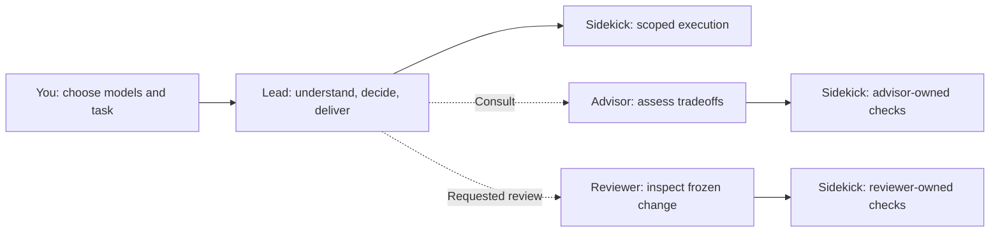

# Fusion Big Boss

**Your models. Clear roles. Controlled delegation.**

Fusion coordinates a lead and specialist workers across **OpenCode, Copilot CLI and Pi**. You choose each role's model and thinking effort; Fusion never selects a replacement.

[OpenCode setup](ai.opencode/README.md) · [Copilot CLI setup](com.github.copilot/README.md) · [Pi setup](pi/README.md)

[Releases and change notes](https://github.com/bluetripod/fusion-big-boss/releases) · Each release tag identifies an exact source snapshot.

## Who does what?

| Role | Responsibility | Tool boundaries |
| :--- | :--- | :--- |
| **Lead** | Understand the source, plan, make decisions, implement, integrate and answer you. | Bounded reads, edits and worker controls. Delegates shell, search and retrieval. |
| **Sidekick** | Execute a fully specified change, file lookup or command; return results and blockers. | Tools depend on its caller (below). Cannot spawn workers. |
| **Advisor** · optional | Challenge a specific decision and explain tradeoffs. | Read-only; delegates checks to its own sidekicks. No direct shell, web or edits. |
| **Reviewer** · optional | Review a frozen change snapshot **when you explicitly ask**. Report findings; the lead owns fixes. | Bounded reads, installed review guidance and its own sidekick. No direct shell, web or edits. |

**One sidekick role, one model selection; separate caller-owned conversations:**
- **Called by the lead:** file tools, shell/Git/tests and host-supported retrieval; can implement scoped changes.
- **Called by an advisor/reviewer:** read/search/shell tools for evidence checks; no named editing tools, and instructions forbid source changes.



## Lead vs sidekick: tool access

**Both can edit code.** The lead understands the source, makes decisions and coordinates work. Its sidekick has the shell, search and execution tools needed to carry out specified assignments. This division applies across all three hosts; native tool names and enforcement mechanisms differ.

- **Runtime:** code blocks a tool call, checks its arguments, or removes the tool. Implemented through hooks, host permissions or fixed tool lists (see below).
- **Prompt:** instructions tell the model how to behave. A hook cannot establish that the model understood the source or stayed within the intent of an assignment.

| Capability | Lead | Lead's sidekick | Where the restriction comes from |
| :--- | :--- | :--- | :--- |
| Read source files | Yes—explicit ranges of at most **350 lines per call** | Yes—no Fusion-specific 350-line cap | **Runtime:** lead read-argument checks. Focused source reading is **prompt** guidance. |
| Create/edit files | Yes, including multi-file changes | Yes, within its assignment | Tools are available to both. Staying within the authorized change is **prompt** guidance; normal host permissions still apply. |
| Search files/content | **Blocked**—delegates lookups | Allowed: host tools such as `grep`, `glob` or `find` | **Runtime:** lead search tools blocked. Returning only paths/ranges for lookup jobs is **prompt** guidance. |
| Run shell commands | **Blocked** | Allowed | **Runtime:** lead shell tools blocked or unavailable. Exact command scope and approvals are **prompt** rules. |
| Run tests, builds and Git commands | Delegates to the sidekick | Allowed within scope and approvals | **Runtime:** shell restriction. Routing all ordinary Git/check work through the sidekick is also a **prompt** rule. |
| Search the web / fetch URLs | Delegates retrieval | Native web tools in OpenCode/Copilot when available; Pi can run a specified URL-fetch command through its shell | **Runtime:** lead native web tools blocked; Pi has no native web tools. Retrieval scope and approvals are **prompt** rules. |
| Start other agents | Can start sidekick, advisor and reviewer workers | **Blocked** | **Runtime:** delegation graph enforced. Calling the reviewer only when the user asks is a **prompt** rule. |
| Inspect, message or cancel workers | Yes, for workers it owns | **Blocked** | **Runtime:** ownership checks; sidekicks cannot use worker-control tools. |
| Choose worker models | Uses your configured choices | Cannot choose replacements | **Runtime:** configuration checks and per-call overrides rejected. Never choosing a fallback is also a **prompt** rule. |

An **advisor/reviewer's sidekick** has a narrower tool set: file reads/lookups and shell checks, with named editing tools blocked at runtime. Preserving source, avoiding commits/pushes and keeping shell commands evidence-only are **prompt** rules. It belongs to that advisor/reviewer; the lead cannot borrow it for coding.

### How each host enforces this

| Host | Runtime mechanism | Boundary |
| :--- | :--- | :--- |
| **OpenCode** | [Agent permissions](ai.opencode/agents/) + [pre-execution hooks and tool filtering](ai.opencode/index.ts) | Lead restrictions target native tool names; evidence roles have narrower tool lists. |
| **Copilot CLI** | [Pre-tool hooks, role checks and policies](com.github.copilot/extensions/fusion-guard/) | Lead restrictions target recognized tool names; evidence roles use allowlists. The guard must be loaded and approved. |
| **Pi** | [Lead tool-call hook](pi/index.ts) + [fixed SDK worker tool lists](pi/worker.ts) | Lead calls use an allowlist; child extensions are disabled to preserve worker tool boundaries. |

OpenCode/Copilot lead guards are **not universal allowlists for arbitrary MCP or third-party tools**. All runtime restrictions depend on the adapter being active and loaded. Shell access can still modify files: these guards are **not an OS sandbox**.

### Optional Pi MXC tool sandbox

Load both the updated independent sandbox extension and this Fusion extension in the same parent Pi host (replace paths; documentation example only):

```sh
pi -e /absolute/sandbox/pi/index.ts -e /absolute/fusion/pi/index.ts
```

At each worker launch, Fusion requests a factory through the synchronous `agent-sandbox:worker-tools` event with `{provide(factory)}`. The sandbox extension supplies `createSandboxTools(cwd, {readOnly?, textOnly?})`; `Launch.sandboxTools` propagates to new/resumed workers and nested evidence workers even though child extensions remain disabled. Role allowlists are retained: only required native-name replacements are installed, and any missing replacement refuses launch. Once a provider has been seen, its absence refuses launch; a previously sandboxed child marked `fusion.pi.sandbox` cannot resume without the factory. Advisor/reviewer reads remain text-only and bounded to 350 lines, and evidence-only sidekicks receive read-only tools.

Ordinary Fusion use without the sandbox extension is unchanged and has no extra hard runtime dependency. The sandbox's native `grep`/`find` wrappers require preinstalled `rg` and `fd`/`fdfind` on its sanitized PATH and fail closed without them; use system grep/find through sandboxed Bash as an alternative. This is tool-scoped MXC containment, not whole-agent isolation or coverage of arbitrary MCP/plugins. The Pi suite, typecheck and a real-MXC handoff/resume/read-only evidence probe passed locally. These package edits have not been installed live. Nothing automatically enables this integration, changes global configuration or selects a model.

## How delegation works

For example, when you ask the lead to fix a bug:

1. **Locate:** if the file location is unknown, the lead gives a sidekick specific search roots and symbols/patterns. The sidekick returns paths and line ranges.
2. **Understand:** the lead reads those ranges itself, diagnoses the problem and decides what should change.
3. **Implement:** the lead edits directly or sends a precise coding assignment: working directory, target files/symbols, desired behavior, constraints, approvals, checks and stop conditions. File count alone does not require delegation.
4. **Verify:** the sidekick runs specified tests/build/Git commands and reports results. Ambiguity or failures return to the lead for diagnosis rather than triggering an independent repair loop.
5. **Finish:** the lead reviews the changes and evidence, integrates the result and answers you.

This workflow is **prompt-guided**, through the [shared briefing](skills/fusion-delegation/SKILL.md) and role instructions. Runtime guards enforce tool access, worker ownership and model configuration—not the quality or completeness of the assignment.

### The actual handoff

The lead sends the assignment in a tool call that starts a background sidekick conversation and returns its ID. The sidekick returns results to its caller. Related follow-ups reuse that conversation where the host supports it; independent, non-conflicting jobs can use separate workers in parallel. One active assignment per worker is the workflow rule.

| Host | Start / continue an assignment | Inspect / steer / cancel |
| :--- | :--- | :--- |
| **OpenCode** | `subagent` with `background: true`; reuse its `sessionID` for follow-ups | `fusion_worker`: `status`, `message`, `cancel` |
| **Copilot CLI** | `task` with `mode: background`; `write_agent` continues an idle worker | `read_agent`, `write_agent`, `fusion_cancel` |
| **Pi** | `fusion_delegate` with `background: true`; reuse its `sessionID` for follow-ups | `fusion_worker`: `status`, `message`, `cancel` |

The assignment must carry the context the worker needs; a role name alone is not a handoff. Copilot cannot resume terminal workers, so a new task needs an explicit context/evidence handoff. Worker IDs and ownership are runtime-checked; choosing useful context and coordinating conflicting edits are prompt responsibilities.

## Use it

1. Follow your host's setup guide above.
2. Run **`/fusion`** and explicitly apply your model choices. Advisor and reviewer are optional.
3. Give the lead a task. For review, ask: **“Do a code review with the Fusion reviewer.”**

While work runs, callers can **inspect progress, send messages and request cancellation**. “Wrap up with findings and unfinished checks” is an ordinary message. Cancellation preserves history and edits; it is cooperative, not rollback.

**Automatic supervision:** every minute, Fusion checks active workers and sends each owner a grouped update. Prompts ask workers to be concise while preserving useful detail; status messages are not truncated. Quiet workers receive one progress request until activity changes; the owner decides whether to intervene. Status checks use no model calls; processing updates can use tokens.

### Host differences

- **Context:** OpenCode/Pi offer per-role local context budgets. Copilot currently uses native `default` / `long_context` tiers. Budgets are not spending caps.
- **Continuation:** OpenCode/Pi queue same-worker follow-ups. Copilot's `write_agent` steers a running worker or continues an idle one; terminal tasks cannot resume.
- **Supervision delivery:** OpenCode supplies the latest update at a model boundary or wakes an idle owner; Pi delivers on a check when its owner is idle. Copilot coalesces native queued messages; foreground advisors cannot receive native supervision messages.
- **Tools & lifecycle:** Pi has no native web-search/fetch tools, disables child extensions, and aborts/drains workers on navigation. Adapter guides cover installation, skills and other host limits.

## Development

`ai.opencode/`, `com.github.copilot/` and `pi/` contain the host adapters; `shared/` and `skills/` hold common helpers and delegation guidance.

```bash
npm ci
npm run check
```

Checks cover adapter behavior, typechecking, shared-briefing drift and offline packaging. OpenCode tests also require Bun. After editing the shared briefing, run `npm run sync:briefing` to refresh generated profiles.
