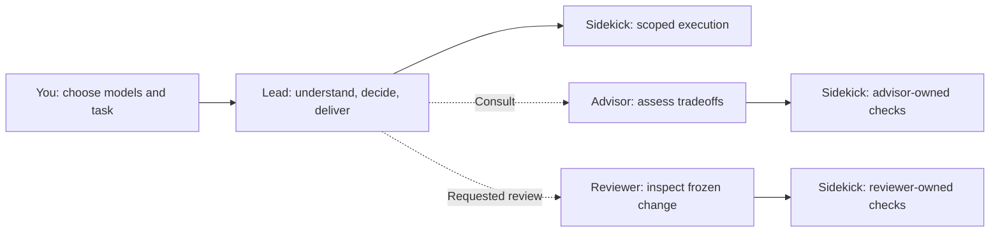

# Fusion Big Boss

**Your models. Clear roles. Controlled delegation.**

Fusion coordinates a lead and specialist workers across **OpenCode, Copilot CLI and Pi**. You choose each role's model and thinking effort; Fusion never selects a replacement.

[OpenCode setup](ai.opencode/README.md) · [Copilot CLI setup](com.github.copilot/README.md) · [Pi setup](pi/README.md)

## Who does what?

| Role | Responsibility | Tool boundaries |
| :--- | :--- | :--- |
| **Lead** | Understand the source, plan, make decisions, implement, integrate and answer you. | Bounded reads, edits and worker controls. Delegates shell, search and retrieval. |
| **Sidekick** | Execute a fully specified change, file lookup or command; return results and blockers. | Tools depend on its caller (below). Cannot spawn workers. |
| **Advisor** · optional | Challenge a specific decision and explain tradeoffs. | Read-only; delegates checks to its own sidekicks. No direct shell, web or edits. |
| **Reviewer** · optional | Review a frozen change snapshot **when you explicitly ask**. Report findings; the lead owns fixes. | Bounded reads, installed review guidance and its own sidekick. No direct shell, web or edits. |

**One sidekick role, one model selection; separate caller-owned conversations:**
- **Called by the lead:** file tools, shell/Git/tests and host-supported retrieval; can implement scoped changes.
- **Called by an advisor/reviewer:** read/search/shell tools for evidence checks; no named editing tools, and instructions forbid source changes.



The lead reads and interprets source itself. For lookups, sidekicks return locations; for implementation, they receive exact scope and checks. Reuse a worker for related tasks, with one active task per conversation; independent workers can run in parallel.

## How restrictions work

**Runtime enforcement** checks tool calls before execution:

| Guard | What it checks |
| :--- | :--- |
| **Read bounds** | Lead/advisor/reviewer reads require explicit ranges of at most **350 lines**. |
| **Role tools** | Blocks restricted shell/search/web calls; read-only workers cannot use named editing tools. |
| **Ownership** | Callers can resume, inspect, message or cancel only their own sidekicks. The lead cannot borrow an advisor/reviewer's sidekick for coding. |
| **Model selection** | Delegation validates user-selected configuration and rejects unauthorized model overrides. |

| Host | Enforcement | Delegation & live controls |
| :--- | :--- | :--- |
| **OpenCode** | [Agent permissions](ai.opencode/agents/) + [plugin hooks](ai.opencode/index.ts) | `subagent` · `fusion_worker` |
| **Copilot CLI** | [Pre-tool hooks, role checks and policies](com.github.copilot/extensions/fusion-guard/) | `task` · `read_agent` · `write_agent` · `fusion_cancel` |
| **Pi** | [Lead tool-call guard](pi/index.ts) + [restricted SDK worker tools](pi/worker.ts) | `fusion_delegate` · `fusion_worker` |

> **Instructions are a separate layer.** “Delegate only precise tasks,” “review only when asked,” and “preserve source during evidence checks” come from the [shared briefing](skills/fusion-delegation/SKILL.md). Hooks cannot judge task clarity or model understanding. Shell commands can still modify files: these guards are **not an OS sandbox**.

## Use it

1. Follow your host's setup guide above.
2. Run **`/fusion`** and explicitly apply your model choices. Advisor and reviewer are optional.
3. Give the lead a task. For review, ask: **“Do a code review with the Fusion reviewer.”**

While work runs, callers can **inspect progress, send messages and request cancellation**. “Wrap up with findings and unfinished checks” is an ordinary message. Cancellation preserves history and edits; it is cooperative, not rollback.

**Automatic supervision:** every minute, Fusion checks active workers and sends each owner a grouped update. Prompts ask workers to be concise while preserving useful detail; status messages are not truncated. Quiet workers receive one progress request until activity changes; the owner decides whether to intervene. Status checks use no model calls; processing updates can use tokens.

### Host differences

- **Context:** OpenCode/Pi offer per-role local context budgets. Copilot currently uses native `default` / `long_context` tiers. Budgets are not spending caps.
- **Continuation:** OpenCode/Pi queue same-worker follow-ups. Copilot's `write_agent` steers a running worker or continues an idle one; terminal tasks cannot resume.
- **Supervision delivery:** OpenCode supplies the latest update at a model boundary or wakes an idle owner; Pi delivers on a check when its owner is idle. Copilot coalesces native queued messages; foreground advisors cannot receive native supervision messages.
- **Tools & lifecycle:** Pi has no native web-search/fetch tools, disables child extensions, and aborts/drains workers on navigation. Adapter guides cover installation, skills and other host limits.

## Development

`ai.opencode/`, `com.github.copilot/` and `pi/` contain the host adapters; `shared/` and `skills/` hold common helpers and delegation guidance.

```bash
npm ci
npm run check
```

Checks cover adapter behavior, typechecking, shared-briefing drift and offline packaging. OpenCode tests also require Bun. After editing the shared briefing, run `npm run sync:briefing` to refresh generated profiles.
